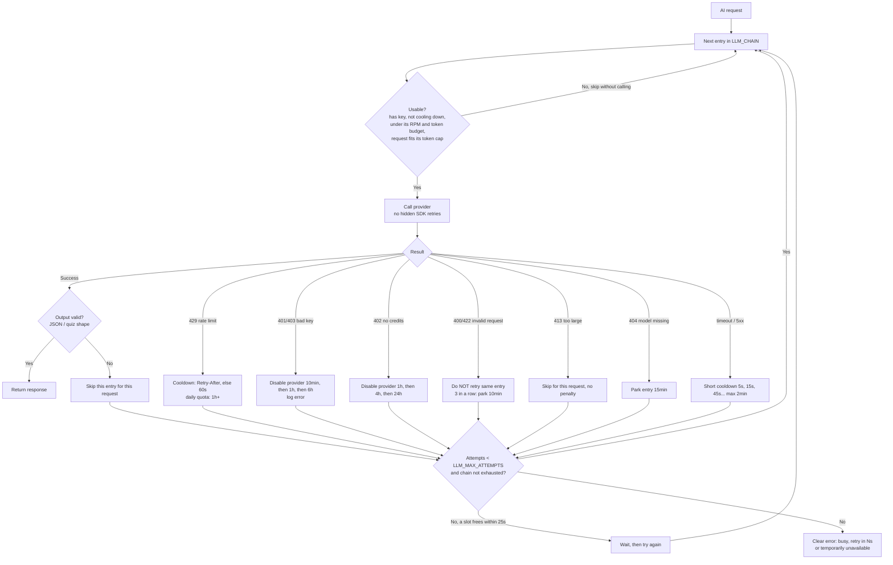

# LLM routing

Every LLM call in the app goes through `app/core/llm_router.py`. It walks an ordered
chain of `provider:model` entries (`LLM_CHAIN` in `.env`) and returns the first usable answer.

Default chain:

| # | Entry | Why here |
|---|---|---|
| 1 | `groq:openai/gpt-oss-20b` | Fast, 30 req/min. Free plan is only **8K tokens/min**, so big requests skip it. |
| 2 | `openrouter:google/gemma-4-31b-it:free` | Free; account-wide rate limit shared with #3. |
| 3 | `openrouter:google/gemma-4-26b-a4b-it:free` | Second OpenRouter model. |
| 4 | `gemini:gemini-3.5-flash-lite` | Verified free-tier Flash-Lite (~500 requests/day). Kept late to save Gemini. |
| 5 | `huggingface:openai/gpt-oss-20b` | Independent quota pool, but only ~$0.10/month of credits: last resort. |
| - | nothing left | Clear message to the user (HTTP 429 "try in ~Ns" or 503 "temporarily unavailable"). |

## Checking it

Admin only: `GET /api/v1/admin/llm-status` shows the active chain, entries skipped for
missing keys, requests/tokens used in the last minute, cooldowns, disabled providers
(bad key / no credits) and the last error per entry.

## Notes

- Counters are in memory (single uvicorn process). With several workers, lower the `*_RPM` values.
- Free tiers can use prompts to improve their products (Google says so for the unpaid Gemini API),
  and free OpenRouter models are run by third parties. Avoid sending sensitive resumes if that matters to you.
- Model names change often. If a log line says "model not found", edit `LLM_CHAIN`.
